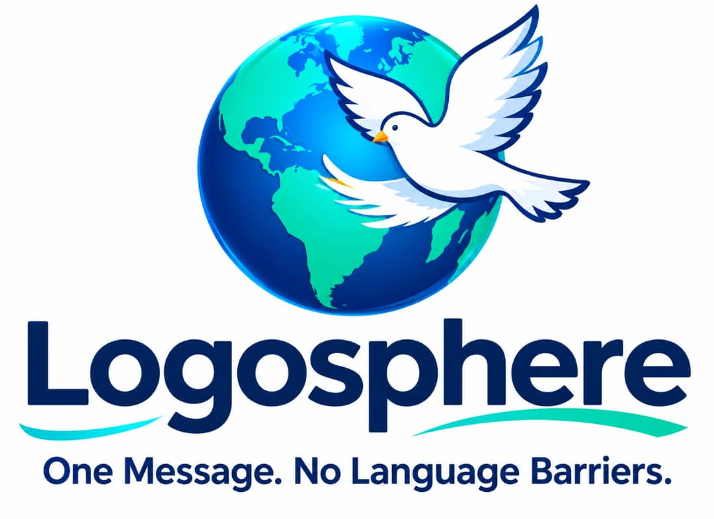

<div align="center">



# LOGOSPHERE

**One Message. No Language Barriers.**

An AI-powered multilingual communication and interpretation platform.

[](#)
[](#)
[](#)

[Website](https://app.logosphere.workers.dev) · [Features](#-core-products) · [Architecture](#-how-logosphere-works) · [Getting Started](#-getting-started)

</div>

---

## 🌍 About Logosphere

Language should never be a barrier to understanding, sharing knowledge, or communicating ideas.

Logosphere is an AI-powered multilingual communication platform designed to eliminate language barriers through real-time speech recognition, intelligent translation, and natural voice generation.

The platform brings together speech-to-text, machine translation, and text-to-speech technologies to make communication across different languages more accessible.

Initially designed to address language barriers in churches and Christian ministry, Logosphere is built with a broader vision: making multilingual communication accessible to individuals, organizations, communities, and people around the world.

Whether it is a preacher delivering a sermon, a missionary sharing the Gospel, or two people communicating across different languages, Logosphere aims to ensure that the message is understood.

**Our Mission**

To make language-independent communication accessible to everyone through artificial intelligence.

**Our Vision**

A world where language differences no longer prevent people from understanding one another.

---

## 🚀 Core Products

Logosphere is built around three interconnected areas of multilingual communication.

### 1. Live Sermon Interpretation

AI-powered real-time interpretation for churches, ministries, conferences, and religious gatherings.

Logosphere enables a speaker to deliver a message in one language while listeners receive translated audio in their preferred languages.

**Key capabilities:**

- Real-time speech recognition.
- Live transcription.
- AI-powered multilingual translation.
- Text-to-speech audio generation.
- Multiple target-language support.
- Configurable source languages.
- QR-code-based listener access.
- Personal listening through smartphones and headphones.
- Potential routing to dedicated audio channels for different languages.

**How it works:**

1. The speaker delivers a message.
2. The system captures the audio.
3. Speech recognition converts speech into text.
4. The translation engine processes the message into selected languages.
5. Text-to-speech generates translated audio.
6. Listeners receive the interpretation in their selected languages.

The goal is to make multilingual church services possible without requiring a separate human interpreter for every language.

### 2. Recorded Sermon Translation

A multilingual translation solution for previously recorded sermons, teachings, podcasts, and ministry audio content.

The objective is to help churches and ministries extend the reach of their existing content beyond their original language.

**Planned capabilities include:**

- Audio upload and processing.
- Automatic speech transcription.
- Multilingual translation.
- AI-generated voice output.
- Translated audio production.
- Downloadable multilingual content.
- Distribution of translated messages.

### 3. Multilingual Evangelism & Outreach

Communication should not stop at the church building.

Logosphere aims to make multilingual communication available for evangelism, missionary work, outreach programmes, and everyday conversations.

The long-term vision includes two-way communication between people who speak different languages.

**Planned capabilities:**

- Speech-to-text conversion.
- Bidirectional language translation.
- AI voice generation.
- Conversational audio translation.
- Language selection.
- Cross-language communication.

The objective is simple: allow people to communicate naturally without needing to speak the same language.

---

## 🗣️ Language Support

Logosphere is designed with multilingual and multilingual-source capabilities.

It is not restricted to English as the original language.

**Initial Language Priorities**

| Language | Code |
|---|---|
| English | en |
| Igbo | ig |
| Yoruba | yo |
| Hausa | ha |
| French | fr |
| Spanish | es |
| Portuguese | pt |

Our long-term objective is to expand support to additional African and international languages.

> **Important:** Actual language availability depends on the speech recognition, translation, and voice-generation providers integrated into the deployment.

---

## ⚡ Key Features

| Feature | Description |
|---|---|
| Real-Time Interpretation | Converts spoken messages into other languages. |
| Speech Recognition | Converts audio into machine-readable text. |
| AI Translation | Translates messages between supported languages. |
| Text-to-Speech | Converts translated text into spoken audio. |
| QR Listener Access | Allows listeners to access interpretation through QR codes. |
| Personal Audio | Enables listeners to use their own smartphones and headphones. |
| Multiple Languages | Supports multilingual communication workflows. |
| Source Language Selection | Allows the original language to be configured. |
| Recorded Audio Translation | Designed for processing previously recorded messages. |
| Bidirectional Communication | Roadmap for conversations across different languages. |

---

## 🔄 How Logosphere Works

Logosphere combines different AI technologies into a multilingual communication pipeline.

**Live Interpretation Pipeline**

<div align="center">

| 🎤 **AUDIO INPUT**<br/>Speaker's voice | → | 🎧 **SPEECH RECOGNITION**<br/>Speech-to-text | → | 🌍 **TRANSLATION**<br/>Language processing |
|:---:|:---:|:---:|:---:|:---:|
| 📱 **LISTENER**<br/>Personal device | ← | 🔊 **AUDIO OUTPUT**<br/>Generated speech | ← | 🗣️ **TEXT-TO-SPEECH**<br/>Voice generation |

</div>

**Listener Experience**

The intended listener experience is straightforward:

1. Scan the church's Logosphere QR code.
2. Open the interpretation interface.
3. Select a preferred language.
4. Connect headphones.
5. Listen to the translated message.

The system is designed to support multiple listeners receiving different language interpretations from the same original message.

---

## 🏗️ Technology & Architecture

Logosphere uses an AI-driven architecture combining speech processing, language translation, and voice synthesis.

The architecture is designed around modular service integrations so individual AI providers can be changed or upgraded without rebuilding the entire platform.

**Core Technology Areas**

| Layer | Responsibility |
|---|---|
| Frontend | User interfaces and listener experience |
| Backend | Application logic and service orchestration |
| Speech-to-Text | Speech recognition and transcription |
| Translation Engine | Multilingual text translation |
| Text-to-Speech | Natural voice generation |
| Database | Application and user data |
| Authentication | User identity and access management |
| Real-Time Processing | Audio and translation workflows |
| Cloud Infrastructure | Hosting and application deployment |

**AI Technologies Under Exploration**

The project has explored or considered technologies including:

- Intron Labs: Speech recognition and speech synthesis for African languages.
- Meta NLLB-200: Multilingual neural machine translation.
- Meta Seamless Communication: Multilingual speech and translation research.
- Deepgram: Speech and voice API capabilities.
- AssemblyAI: Speech-processing capabilities.
- VibeVoice: Voice generation research.
- ElevenLabs: Natural-sounding voice generation and voice cloning.

These technologies are potential integrations and research references, not a declaration that every provider is currently connected to the production application.

---

## 🎯 Who Is Logosphere For?

**Churches and Ministries**
Deliver multilingual services and make sermons accessible to more people.

**Pastors and Preachers**
Communicate messages to audiences who speak different languages.

**Missionaries**
Reach communities across language boundaries.

**Evangelism Organizations**
Make multilingual outreach and communication easier.

**Conference Organizers**
Support multilingual audiences at conferences, seminars, and events.

**Individuals and Communities**
Communicate across language differences.

---

## 🛣️ Development Roadmap

Logosphere is being developed as an expandable multilingual communication ecosystem.

| Area | Development Objective |
|---|---|
| Live Interpretation | Real-time multilingual sermon interpretation |
| African Languages | Expanded Nigerian and African language support |
| Listener Experience | QR-based access and personal audio |
| Voice Generation | More natural multilingual speech |
| Recorded Translation | Multilingual sermon and audio processing |
| Bidirectional Translation | Two-way conversational interpretation |
| Church Audio Integration | Dedicated language audio channels |
| Global Expansion | Additional international languages |
| AI Optimization | Lower latency and improved translation accuracy |

> Roadmap items are development objectives and do not necessarily represent currently deployed features.

---

## 💻 Getting Started

**Requirements:** [Bun](https://bun.sh) (the project uses `bun.lock`).

Clone the repository and install dependencies:

```bash
git clone https://github.com/Emmanuel-Onwuka-dev/logosphere.git
cd logosphere
bun install
```

Create your local environment file from the example and fill in your own keys:

```bash
cp .env.example .env.local
```

On Windows PowerShell, use `Copy-Item .env.example .env.local` instead. Never commit `.env.local`; it is git-ignored.

Start the development server:

```bash
bun run dev
```

Run the unit tests, and build the application:

```bash
bun run test
bun run build
```

End-to-end tests run with `bun run test:e2e`. Set `E2E_BASE_URL` to test a deployed site.

---

## 🔐 Security

Logosphere takes the security of application data and integrations seriously.

Development and deployment should follow these principles:

- Never expose API keys or credentials in source code.
- Store secrets in environment variables.
- Validate user input.
- Apply appropriate authentication and authorization.
- Protect uploaded audio and user data.
- Use secure API communication.
- Apply appropriate access controls to stored recordings.

---

## 🌱 Our Philosophy

Communication is more than the exchange of words.

It is about understanding, connection, knowledge, culture, and the ability to share ideas.

For churches, it means that someone should not be excluded from understanding a message simply because they speak another language.

For communities, it means that differences in language should not prevent meaningful interaction.

For the world, it means building bridges where barriers once existed.

Logosphere exists to make that possible.

---

<div align="center">


**One Message. No Language Barriers.**

Powered by AI. Built for Understanding.

[Visit Logosphere](https://app.logosphere.workers.dev)

</div>
